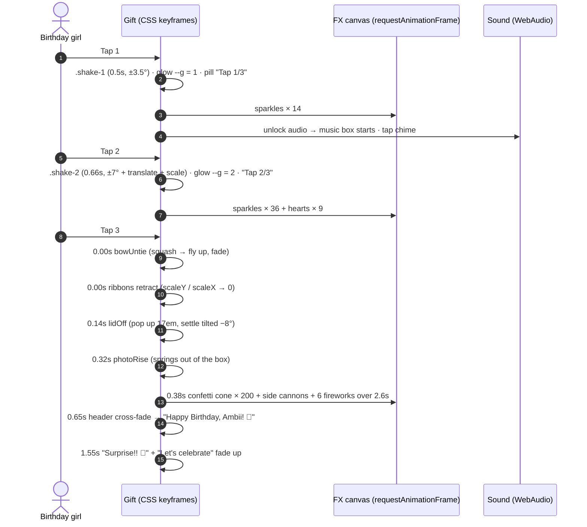
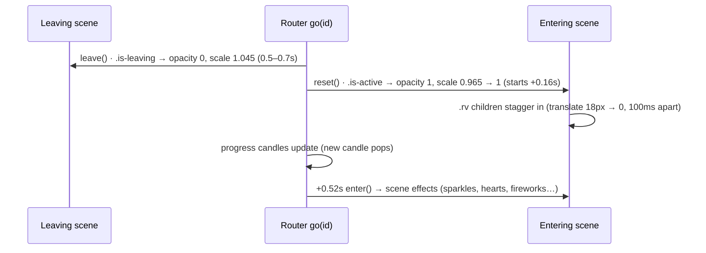

# 🎁 Birthday Surprise

An interactive, animated birthday surprise website: tap a gift box three times, light the candles, make a wish, cut the cake, pop balloons, open a card and read a letter. It ends with a finale and a downloadable "birthday crown".

Pure **HTML + CSS + vanilla JavaScript**. No frameworks, no build step, no dependencies.

---

## 1. Quick start

```bash
# from this folder
python -m http.server 8000        # or: npx serve .
# open http://localhost:8000
```

Opening `index.html` straight from disk also works. A local server is closer to how GitHub Pages serves the site.

**Jump straight to a scene** (handy while editing): add `?scene=<id>` to the URL.
For example, `http://localhost:8000/?scene=letter`.
Scene ids: `gift`, `candles`, `wish`, `wished`, `cut`, `slice`, `balloons`, `reasons`, `card`, `letter`, `finale`.

---

## 2. Project structure

```
HBD-anime/
├── index.html              # markup for all 11 scenes + chrome (progress, nav, music)
├── style.css               # mobile-first styles, all CSS keyframes
├── script.js               # CONFIG, audio engine, canvas FX engine, router, scene logic
├── README.md
├── .nojekyll               # tells GitHub Pages to serve files as-is
└── assets/
    ├── favicon.svg
    ├── stickers/           # small photos shown in frames (replace with your own)
    │   ├── hug.svg         #   pops out of the gift box
    │   ├── cake.svg        #   "Your wish is on its way" note
    │   ├── wave.svg        #   between the balloons
    │   └── cheer.svg       #   above the "Things I love about you" list
    └── audio/              # optional: drop bgm.mp3 here (see CONFIG.music)
```

The `page*.png` screenshots in the root are the design references. The site doesn't use them, so you can move them into a `reference/` folder or delete them before deploying.

---

## 3. Personalise it

Everything personal lives in the `CONFIG` object at the top of **`script.js`**:

| Key | What it controls |
|---|---|
| `name`, `nickname`, `from`, `age` | Names everywhere, the "23" cake topper, the card and the crown |
| `photos.surprise / wish / balloons / reasons` | Images in the four photo frames (jpg, png, gif, webp or svg) |
| `wishNote`, `sliceNote` | The two handwritten notes |
| `reasons` (5) | One per balloon, revealed in pop order, then listed |
| `letter` | Greeting, paragraphs, sign-off and signature |
| `crownTitle` | Text on the finale crown card and the downloadable PNG |
| `contact.whatsapp` | Number with country code, so "Tell Santhosh" opens WhatsApp (empty means share sheet or clipboard) |
| `music.src` | Empty means the built-in music box melody; or a path such as `assets/audio/bgm.mp3` |

Recommended photo size is about 600×600 for the stickers. Compress them (for example with squoosh.app) so the page loads fast on mobile data.

---

## 4. Scene flow

The 8 candles in the top-left pill light up as she progresses. They mirror the reference screenshots.

```mermaid
flowchart LR
  A["🎁 gift<br/>(page1)"] -- "tap ×3" --> A2["gift opened<br/>(page1-1)"]
  A2 -- "Let's celebrate" --> B["🕯️ candles<br/>(page2)"]
  B -- "light 5 / Light them all" --> C["🤫 wish<br/>(page2-2)"]
  C -- "hold to blow" --> D["✨ wished<br/>(page2-3)"]
  D -- "Cut the cake" --> E["🔪 cut<br/>(page3)"]
  E -- "swipe / tap link" --> F["🍰 slice<br/>(page3-2)"]
  F -- "Pop the balloons" --> G["🎈 balloons<br/>(page4)"]
  G -- "pop ×5" --> H["💗 reasons<br/>(page4-2)"]
  H -- "Read my letter" --> J["💌 card<br/>(page6)"]
  J -- "tap card" --> K["✉️ letter<br/>(page7)"]
  K -- "I read it" --> L["🎂 finale<br/>(page8)"]
```



| Progress | Scenes |
|---|---|
| 1 candle | gift |
| 2 | candles |
| 3 | wish, wished |
| 4 | cut, slice |
| 5 | balloons, reasons |
| 6 | card |
| 7 | letter |
| 8 | finale |

---

## 5. Animation sequence diagram

### 5.1 Gift box (the 3-tap opening)



### 5.2 Every scene change



### 5.3 Per-scene timeline

| Scene | Trigger | What animates |
|---|---|---|
| candles | tap a candle / *Light them all* | flame scales in with a springy overshoot, then flickers (CSS); sparkles at the wick (canvas); when all 5 are lit there's a burst, then the wish scene |
| wish | press **and hold** | button fills left→right (rAF, 1.7s); flames lean and shrink with the "breath"; at 100% the flames go out with rising smoke (CSS), then confetti, 3 fireworks and the wished scene |
| cut | swipe across the cake | knife follows the finger and leaves a sparkle trail; once enough of the swipe crosses the cake, the knife slides down the dashed guide, the halves spring apart and show the sponge inside, then sparkles and confetti |
| balloons | tap a balloon | balloon swells, then pops (CSS); shards and confetti burst (canvas); the note card swaps in the next reason |
| card | tap | 3D cover flip (`rotateY −168°`, perspective 1700px), hearts and sparkles, then the letter |
| letter | – | paragraphs "ink in" one after another (blur → sharp, 0.75s apart) on ruled paper |
| finale | – | confetti, side cannons, 9 fireworks, falling confetti rain, bouncing bear with beating heart eyes; tap anywhere for more fireworks |

### 5.4 How each mandatory effect is built

| Effect | Technique |
|---|---|
| Confetti | Canvas particles (`FX.confetti`, `FX.cannons`, `FX.rain`): gravity, air drag, 3D flip, sway |
| Fireworks | Canvas rockets with ember trails that explode into glittering spark rings plus a flash |
| Sparkles | Canvas 4-point stars, plus twinkling ✨ in the background (CSS) |
| Floating balloons | SVG balloons rising and swaying (CSS `rise` + `sway`), plus the poppable balloons |
| Floating hearts | 💗 rising every few seconds (CSS `heartRise`), plus canvas heart bursts |
| Gift opening | CSS keyframes `shake1`, `shake2`, `bowUntie`, `lidOff`, `photoRise` |
| Page transitions | CSS opacity and scale transitions, plus staggered reveals of each element |
| Mobile responsive | Mobile-first CSS with `clamp()` and `min(vw, vh)` sizing, pointer events, safe-area insets |
| Music + mute | WebAudio music box "Happy Birthday" (public domain melody) with soft echo; the bottom-left button toggles it and the choice is remembered |

Performance: one shared `requestAnimationFrame` loop draws all burst effects and stops itself when nothing is on screen. Only `transform` and `opacity` are animated. The device pixel ratio is capped at 2, and phones get fewer particles. With `prefers-reduced-motion`, movement is turned off and only fades remain.

---

## 6. Asset list

| Asset | Where it's used | Source / licence | Replace? |
|---|---|---|---|
| `assets/stickers/hug.svg` | Photo that rises out of the gift | Original illustration made for this project | ✅ your photo or GIF |
| `assets/stickers/cake.svg` | Wish note | Original | ✅ |
| `assets/stickers/wave.svg` | Balloons scene | Original | ✅ |
| `assets/stickers/cheer.svg` | Reasons list | Original | ✅ |
| `assets/favicon.svg` | Browser tab icon | Original | optional |
| `assets/audio/bgm.mp3` | Background music (optional) | Not included; use a track you have rights to | optional |
| Gift box, bow, cake, candles, knife, slice, balloons, bear | Drawn inline with SVG and CSS | Part of the code | – |
| Fonts: Grandstander, Fredoka, Caveat | Headings, body, handwriting | Google Fonts (SIL Open Font License) | – |
| Noto Color Emoji | Emoji, so they look the same on every device | Google Fonts (OFL) | – |
| Music box melody | Default background music | "Happy Birthday" melody, public domain, synthesised live | – |

> The reference design used licensed cartoon-character stickers. They've been swapped for original kawaii bears. Use your own couple photos or stickers you have rights to.

---

## 7. Deploy to GitHub Pages

### Option A: command line

```bash
cd HBD-anime
git init
git add .
git commit -m "Birthday surprise 🎁"
git branch -M main
# create an empty repo on github.com first (e.g. "birthday-surprise"), then:
git remote add origin https://github.com/<your-username>/birthday-surprise.git
git push -u origin main
```

Then on GitHub:

1. Open the repo and go to **Settings → Pages**.
2. Under **Build and deployment**, set **Source** to **Deploy from a branch**.
3. Set **Branch** to `main` with folder `/ (root)`, then click **Save**.
4. Wait about a minute. The site will be live at
   `https://<your-username>.github.io/birthday-surprise/`

### Option B: no command line

1. Create a new public repository on github.com.
2. Click **Add file → Upload files** and drag in `index.html`, `style.css`, `script.js`, `.nojekyll` and the whole `assets/` folder.
3. Commit, then follow steps 1–4 above.

### Tips

- All paths are relative, so the site works from a sub-path such as `/birthday-surprise/` without any changes.
- File names are **case-sensitive** on GitHub Pages: `Photo.JPG` ≠ `photo.jpg`.
- After you update the site, hard-refresh (Ctrl/Cmd + Shift + R) or wait a few minutes for the cache.
- To keep the link a surprise, give the repo an unguessable name. Repos on a free plan must be public for Pages, so anyone with the link can see the site.
- Optional custom domain: Settings → Pages → *Custom domain*.

---

## 8. Browser support & accessibility

- Latest Chrome, Edge, Safari (iOS 15.4+), Firefox, Samsung Internet.
- Every interaction is a real `<button>` and works with the keyboard: Enter/Space to tap, **hold Space** to blow, Escape to go back.
- Live regions announce the tap count, lit candles and popped balloons. Focus moves to each new scene's heading.
- With `prefers-reduced-motion`, movement is turned off and the fades remain.
- Audio starts only after the first tap, because browsers block autoplay. The mute choice is remembered.
